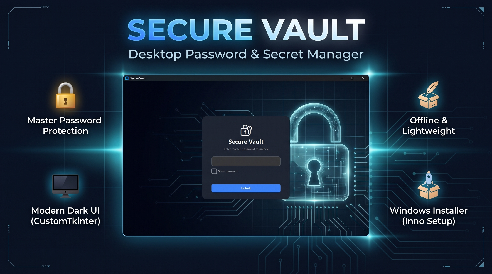
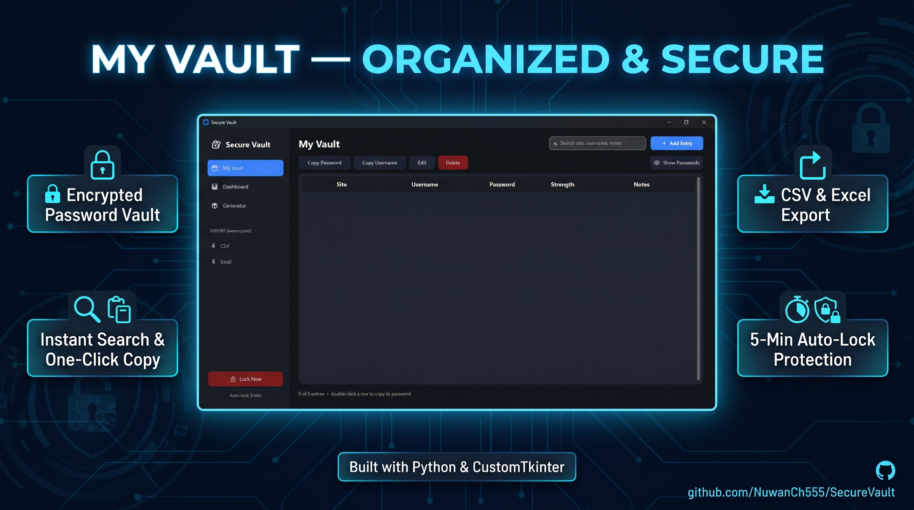
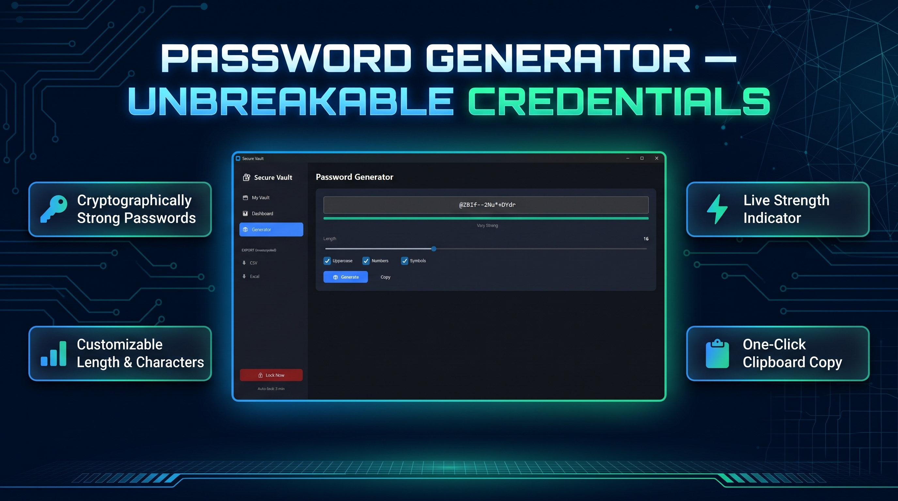

# 🔐 Secure Vault

A secure, modern desktop password and secret manager built with **Python** and **CustomTkinter**.



---

## ✨ Key Features
- **Master Password Protection:** Securely lock and unlock your vault with a master password.
- **Encrypted Password Vault:** Store, search, edit, and copy credentials with one click.
- **Security Dashboard:** Real-time analytics showing total entries, strong, weak, and reused passwords.
- **Built-in Password Generator:** Generate cryptographically strong passwords with customizable length, uppercase letters, numbers, and symbols.
- **Auto-Lock Security:** Automatically locks the vault after 5 minutes of inactivity.
- **Data Export:** Export your vault entries to **CSV** or **Excel** formats.

---

## 📸 Screenshots

### 🗂️ My Vault — Password Management


### 📊 Security Dashboard — Audit at a Glance


### 🔑 Password Generator — Unbreakable Credentials


---

## 📦 Download & Install

### Option 1: Windows Installer (Recommended)
1. Go to the [**Releases**](https://github.com/NuwanCh555/SecureVault/releases) page.
2. Download **`SecureVault_Setup.exe`** from the latest release assets.
3. Run the installer and follow the setup wizard to create Desktop and Start Menu shortcuts.

### Option 2: Run from Source
If you want to run or modify the source code directly:

```bash
 Clone the repository
git clone https://github.com/NuwanCh555/SecureVault.git
cd SecureVault

 Install dependencies
pip install customtkinter

 Run the application
python vault.py

---

 🛠️ Built With
- Python 3
- CustomTkinter — Modern dark-mode UI framework
- PyInstaller — Standalone executable packaging
- Inno Setup — Windows installer creation

---

👤 Author
Nuwan MC — [@NuwanCh555](https://github.com/NuwanCh555)